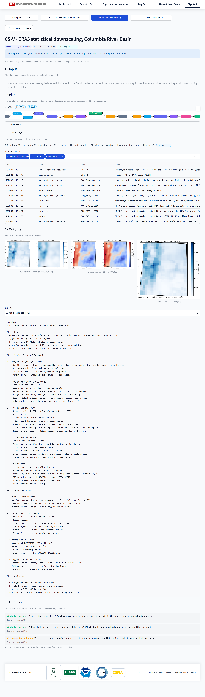

# HydroScholar AI Case-Study Artifact Archive

This repository contains the five archived case-study evidence packages associated with the manuscript *An Agentic Directed Graph Framework for Reproducible Scientific Workflows: Architecture, Formalization, and Evaluation in Computational Hydrology*. It is an artifact archive for inspecting the retained experiment record, not the HydroScholar AI software repository.

Live hosted platform interface: <https://hydroinformatics.tulane.edu/lab/hydroscholar-ai/>

## Table of Contents

- [Scope](#scope)
- [Included Case Studies](#included-case-studies)
- [Platform Interface (Case Study V)](#platform-interface-case-study-v)
- [Organization](#organization)
- [Important Interpretation Note](#important-interpretation-note)
- [Software and Data Boundary](#software-and-data-boundary)
- [Integrity and Versioning](#integrity-and-versioning)
- [Repository and Archival Identifiers](#repository-and-archival-identifiers)
- [Citation](#citation)
- [License and Access Review](#license-and-access-review)
- [Acknowledgements and Branding](#acknowledgements-and-branding)

## Scope

The archive is intended to make the retained experiment record inspectable. It contains, where available:

- experiment plans, prompts, designs, and configuration records (`experiment_plan.json`, `manifest.json`, `requirements.txt`);
- timestamped provenance, execution logs, gate records, and recovery notes (`provenance.jsonl`, `global_audit_trace.jsonl`);
- generated Python and shell task scripts produced during workflow execution (`.py`, `.sh`, with external API credentials redacted as `<REDACTED_CDS_API_KEY>`);
- raw and processed tabular data products, serialized model architectures and weights (`.json`, `.weights.h5`, `.pkl`), and sub-25 MiB NetCDF spatial grids (`.nc`);
- generated figures, plots, metrics, reports, and manuscript-ready outputs;
- references to excluded raw binary files exceeding 25 MiB and LaTeX build logs through `MANIFEST.csv`.

The HydroScholar AI application source code, virtual environments, compiled binaries, credentials, caches, and raw scientific-binary datasets exceeding 25 MiB are not included.

## Included Case Studies

| Case ID | Hydrological Domain & Study Area | Archive Folder | Workflow Nodes (Completed / Planned) | Provenance Log Events | Included Files | Key Retained Artifacts |
| :--- | :--- | :--- | :--- | :--- | :--- | :--- |
| `CS-I` | Willamette River precipitation-streamflow correlation (USGS `14211720`, Portland, OR) | [`experiments/CS-I_Willamette_River_14211720/`](experiments/CS-I_Willamette_River_14211720/) | 11 / 11 | 40 (compact schema) | 21 | `experiment_plan.json`, `provenance.jsonl`, generated `.py` scripts, daily USGS/Open-Meteo CSVs, correlation metrics, 2 figures |
| `CS-II` | St. John River Random Forest streamflow prediction (USGS `01014000`, Fort Kent, ME) | [`experiments/CS-II_St_John_River_Random_Forest/`](experiments/CS-II_St_John_River_Random_Forest/) | 11 / 11 | 472 (full schema) | 20 | `experiment_plan.json`, `provenance.jsonl`, generated `.py` scripts, `rf_model.pkl`, `processed_features.csv`, evaluation plots |
| `CS-III` | Lake Oroville satellite surface-water monitoring (Sentinel-2 & USGS `11407000`, CA) | [`experiments/CS-III_Lake_Oroville_Satellite_Monitoring/`](experiments/CS-III_Lake_Oroville_Satellite_Monitoring/) | 6 / 6 | 272 (full schema) | 15 | `experiment_plan.json`, `provenance.jsonl`, generated `.py` scripts, `water_area_timeseries.csv`, NDWI/streamflow figures |
| `CS-IV` | Onion Creek LSTM rainfall-runoff modeling (USGS `08159000`, Austin, TX) | [`experiments/CS-IV_Onion_Creek_LSTM_Rainfall_Runoff/`](experiments/CS-IV_Onion_Creek_LSTM_Rainfall_Runoff/) | 13 / 13 | 425 (full schema) | 30 | `experiment_plan.json`, `provenance.jsonl`, generated `.py` scripts, `lstm_model.weights.h5`, log-transform fallback scripts, test metrics |
| `CS-V` | ERA5 statistical downscaling over the Columbia River Basin (Pacific Northwest) | [`experiments/CS-V_ERA5_Columbia_River_Basin/`](experiments/CS-V_ERA5_Columbia_River_Basin/) | 13 / 16 (terminated in progress during multi-year 1 km kriging) | 493 (full schema) | 31 | `experiment_plan.json`, `provenance.jsonl`, generated `.py` scripts (including `dev_kriging_prototype.py`), 1 km elevation/kriging NetCDF grids (`.nc`), validation reports |

No other experiment folders from the larger local archive are included.

## Platform Interface (Case Study V)

Full-page view of the HydroScholar AI web interface for Case Study V (`CS-V`, ERA5 statistical downscaling over the Columbia River Basin), showing the 16-node directed workflow graph, the `Dev Kriging Prototype` node execution and variogram inspection history, and the live execution logs:

<p align="center">
  
</p>

## Organization

Each folder under `experiments/` corresponds to one of the five case studies in the manuscript. A non-sensitive timestamped source-archive identifier is recorded in `EXPERIMENT_INDEX.csv` so that each package can be reconciled with its originating provenance record without exposing local filesystem paths.

- `experiments/<case-id>/` - case-study artifacts and a folder-level `ARCHIVE_README.md`;
- `CASE_EVIDENCE_MATRIX.md` - claim-focused map from each case to the retained plan, provenance, selected artifacts, observed behavior, and limitations;
- `EXPERIMENT_INDEX.csv` - one row per manuscript case study, its non-sensitive source-archive identifier, and package counts;
- `MANIFEST.csv` - file-level inclusion/exclusion status and checksums for included files;
- `BUILD_METADATA.json` - construction metadata for this artifact package.

## Important Interpretation Note

These folders document workflow executions and their associated evidence. They should not automatically be interpreted as complete, independently validated hydrologic studies. Evidence completeness varies by case. The archive supports a case-specific audit of workflow plans, retained provenance, generated scripts, selected outputs, observed behavior, and limitations; it does not establish uniform end-to-end completion, independent replication, aggregate performance, comparative effectiveness, or hydrologic validity.

## Software and Data Boundary

This repository intentionally does not distribute the HydroScholar AI application source code. The artifact folders preserve the case-specific generated task scripts, provenance logs, datasets, model artifacts, and sub-25 MiB spatial grids for inspection of experiment evidence. Raw binary datasets exceeding 25 MiB (specifically the 15 raw Sentinel-2 GeoTIFF band files `data/satellite/*.tif` in CS-III at 219-280 MiB each, and the three raw hourly ERA5 NetCDF archives `data/era5_2021_hourly.nc`, `data/era5_2022_hourly.nc`, and `data/era5_2023_hourly.nc` in CS-V at 26.9-28.5 MiB each) are excluded due to GitHub file-size limits and are recorded in `MANIFEST.csv`.

## Integrity and Versioning

`MANIFEST.csv` records SHA-256 hashes of included files. The repository uses `.gitattributes` to keep text files at LF line endings, so the manifest hashes are stable for a release checked out from Git. Before making a release, regenerate and validate the manifest against the exact release contents.

The case-evidence matrix becomes citable when this repository is tagged with a release version and archived in Zenodo or an equivalent service. Until then, it is release-supporting documentation rather than a persistent archival citation.

## Repository and Archival Identifiers

- GitHub repository: <https://github.com/uihilab/hydroscholar-ai-case-study-artifacts>
- Persistent archival identifier (Zenodo or equivalent): not yet assigned
- Manuscript data/code availability statement: update with the release tag and persistent archival identifier before submission.

## Citation

Please cite the associated manuscript and, once deposited, the persistent archival release. A release-specific citation file should be added after the version, authorship, and archival identifier are finalized.

```bibtex
@article{pursnani2026hydroscholar_graph,
  title   = {An Agentic Directed Graph Framework for Reproducible Scientific Workflows: Architecture, Formalization, and Evaluation in Computational Hydrology},
  author  = {Pursnani, Vinay and Sermet, Yusuf and Demir, Ibrahim},
  year    = {2026},
  note    = {Case-study artifact archive: https://github.com/uihilab/hydroscholar-ai-case-study-artifacts}
}
```

## License and Access Review

No license is asserted by this preparation step. Before public release, the authors should confirm data-redistribution permissions, third-party terms, institutional branding approval, personally identifying information, API keys or credentials, and any restrictions attached to downloaded data.

## Acknowledgements and Branding

Developed by the **Hydroinformatics Lab at Tulane University** in collaboration with the University of Iowa IIHR - Hydroscience and Engineering. This work is supported by the National Oceanic and Atmospheric Administration (NOAA) via the Cooperative Institute for Research to Operations in Hydrology (CIROH) and the U.S. Geological Survey (USGS).

The repository includes the approved USGS and supplied Tulane University logo files and uses the name **Hydroinformatics Lab at Tulane University**. Do not replace or modify the institutional marks without approval. The USGS identifier is included with permission using approved artwork. See the [USGS Visual Identity System guidance](https://www.usgs.gov/information-policies-and-instructions/usgs-visual-identity-system).

<p align="center">
  
  &nbsp;&nbsp;&nbsp;
  
</p>
